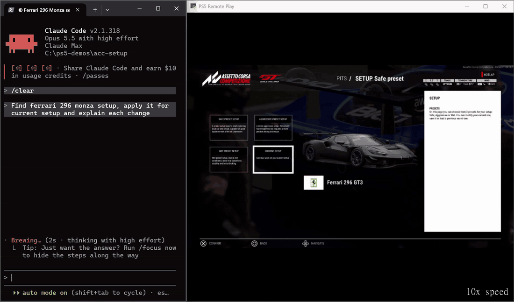

# PS5 Remote Play MCP

**Hand your PS5 controller to an AI agent.** Claude Code, Codex or any MCP client sees the screen of a stock PlayStation 5 and presses its buttons, over Sony's official Remote Play on your home network. No jailbreak, no capture card, one command to add it to your agent.

> "Find ferrari 296 monza setup, apply it for current setup and explain each change"
>
> "I'm struggling in the slow corners: the rear steps out on exit."



*Left: the chat with Claude Code. Right: the PS5 screen the agent is looking at, in Assetto Corsa Competizione. Recorded on a real PS5, sped up 10×.*

The agent searches the web for a Monza setup. The site it picks is behind a bot check, so it says so and takes a reference setup from its knowledge file instead, naming that source. It enters the values in the game's setup menu (traction control, anti-roll bars, rear wing) and saves them as a new setup. Then it fixes the oversteer out of the chicanes: one more step of traction control, a softer rear anti-roll bar and a little more rear toe-in, each change with the rule behind it.

Each step is the same loop: take a screenshot, decide, press buttons, take another screenshot to check what happened.

## What else you can ask

The same loop works wherever the game waits for you. Some ideas:

- **Team and season management.** *"Run a fantasy draft in NBA 2K27 and build a defense-first team."* The agent would read player cards and explain each pick; trades, lineups and rotations are the same kind of menu work.
- **Turn-based battles.** *"Win this fight in Vampire Crawlers and tell me your plan before each move."* Also card games like Balatro and turn-based RPGs: the agent reads enemies and cards and picks a move.
- **Story choices.** *"Play Baldur's Gate 3 as a pacifist."* The agent reads the dialogue and picks the matching line.
- **Builds and tuning.** Spend level-ups for a strength build in Elden Ring, compare two items in Diablo IV, tune a car in Gran Turismo 7.
- **Photo mode.** *"Take a nice shot in Astro Bot: low angle, shallow focus."* Moving the camera needs the sticks, which are not yet verified inside a game.
- **Apps.** *"Help me pick a movie on Netflix for tonight: something like Interstellar, under two hours."* Some video apps hide their picture from Remote Play; the agent then sees a black screen and says so.
- **Console chores.** *"Is the download finished? How much space is left?"*, *"Which Astro Bot trophies are left?"*, *"Limit my kid's playtime to two hours a day."*
- **Accessibility.** The agent describes what is on the screen and moves through menus on request, for players who cannot see the screen well.
- **Testing for game developers.** *"Go through every settings screen and save a screenshot of each"*, or check a translation for cut-off text on a retail console.

### Good at, not good at

- **Good at:** menus and settings, launching games and apps, turn-based and slow-paced games, team and car management, and "what's on the screen right now?"
- **Not good at:** real-time action. One *screenshot → model → button* round trip takes seconds, so shooting, driving a lap or dodging is out of reach.

## How it works

```
Claude Code ──stdio──▶ ps5-remoteplay-mcp ──HTTP (127.0.0.1)──▶ daemon ──Remote Play (LAN)──▶ PS5
```

A long-lived **daemon** owns the single Remote Play session. The thin **MCP server** is started and restarted by your agent and talks to the daemon. Connecting to the console takes a few seconds, so the daemon survives agent restarts and keeps the session warm. It starts automatically on the first tool call.

## Quick start

You need a PS5 on the same network as your computer (Ethernet or Wi-Fi) and [uv](https://docs.astral.sh/uv/).
Tested on Windows 11; macOS and Linux are expected to work but untested.

**0. Install uv** (once; skip if `uv --version` works), then open a new terminal:

```
# Windows (PowerShell)
powershell -ExecutionPolicy ByPass -c "irm https://astral.sh/uv/install.ps1 | iex"
# macOS / Linux
curl -LsSf https://astral.sh/uv/install.sh | sh
```

**1. On the PS5:** Settings → System → Remote Play → **Enable Remote Play**.

**2. Add the server to Claude Code** — one command, no IP address needed:

```
claude mcp add --transport stdio --scope user ps5 -- uvx ps5-remoteplay-mcp
```

No `claude` command in your terminal (you use Claude Code only inside VS Code)? Ask Claude instead:
*"Add a user-scope MCP server named ps5 that runs `uvx ps5-remoteplay-mcp`."* Then restart Claude Code.

**3. Ask the agent:** *"Connect to my PS5."* It finds the console on your network and opens a sign-in window:

1. Sign in to PSN on Sony's page in that window.
2. On the PS5 open **Settings → System → Remote Play → Link Device** and type the 8-digit PIN into the window.

Done. From now on just ask: *"What's on the PS5 screen?"*

> **Tip:** turn on a password for purchases in PlayStation Store. The agent is told never to confirm purchases, but it can physically navigate there.

### Other ways to connect

**Other MCP clients** — Claude Desktop (`claude_desktop_config.json`), Cursor and others (standard `mcpServers` JSON):

```json
{
  "mcpServers": {
    "ps5": { "command": "uvx", "args": ["ps5-remoteplay-mcp"] }
  }
}
```

**Codex** (`~/.codex/config.toml`):

```toml
[mcp_servers.ps5]
command = "uvx"
args = ["ps5-remoteplay-mcp"]
```

**Latest version from GitHub** instead of PyPI: replace `uvx ps5-remoteplay-mcp` with
`uvx --from git+https://github.com/khodossss/ps5-remoteplay-mcp ps5-remoteplay-mcp`.

**Set up from a terminal** instead of through the agent: `uvx ps5-remoteplay-mcp setup`.

### Updating

`uvx` keeps using the version it downloaded first. To move to the newest release, run once and restart your agent:

```
uvx ps5-remoteplay-mcp@latest stop
```

This fetches the latest version and stops the running daemon, so the next tool call starts the new one.

### Optional

- To let the agent **wake the console from rest mode**: Settings → System → Power Saving → Features Available in Rest Mode → turn on **Stay Connected to the Internet** and **Enable Turning On PS5 from Network**.
- **Several consoles** on the network, or discovery blocked: pin one with `PS5_HOST`, e.g. `claude mcp add --env PS5_HOST=192.168.1.50 --transport stdio ps5 -- uvx ps5-remoteplay-mcp`. The console's IP is under Settings → System → System Software → Console Information.

## Usage

Talk to your agent in plain language:

- "What's on the PS5 screen right now?"
- "Open Settings and tell me the system software version, then go back to the home screen."
- "Launch Astro Bot and describe its main menu."
- "In the current menu, move down to *Display and Video* and open it."

The agent looks at a screenshot, presses buttons and looks again. It typically passes `snapshot_after_ms` so a single tool call returns the screen after the input, with `screen_changed` saying whether anything moved.

### Tools

| Tool | Arguments | What it does |
|---|---|---|
| `setup` | `redirect_url?`, `pin?` (chat fallback only) | First run: find the PS5 and link this computer (sign-in window + PIN) |
| `status` | — | Console state (awake/standby), session, fps, age of the latest frame, firmware |
| `wait_ready` | `timeout_s=30` | Wait until the video stream is live again after a reconnect or stall |
| `snapshot` | `max_width=1024`, `quality=80` | Current screen as a JPEG |
| `press` | `button`, `duration_ms=80` | Tap a button |
| `hold` | `button`, `duration_ms` (≤ 10 000) | Hold a button, then release |
| `stick` | `side`, `x`, `y` (-1..1; y=-1 is up), `duration_ms` | Deflect a stick, then re-center |
| `trigger` | `side`, `value` (0..1), `duration_ms` | Analog L2/R2 |
| `sequence` | `steps[]` | Several inputs in one call (press / hold / stick / trigger / wait) |
| `release_all` | — | Release every button, center the sticks, release the triggers |
| `disconnect` | — | End the Remote Play session and stop the daemon, handing the console back |
| `wake` | — | Wake the console from rest mode |
| `standby` | `confirm="yes"` | Put the console into rest mode |
| `viewer` | `show` | Open or close a window with the live picture on the user's computer. Closed by default; the agent opens it when you ask to see the screen |

Every input tool (`press` … `sequence`) also takes `snapshot_after_ms` (return the screen that long after the input) and `until_change` (return as soon as the screen changes, waiting at most `snapshot_after_ms`).

Buttons: `cross circle square triangle up down left right l1 r1 l2 r2 l3 r3 options create touchpad ps`.

A `sequence` example:

```json
[{"op": "press", "button": "down"}, {"op": "wait", "duration_ms": 400}, {"op": "press", "button": "cross"}]
```

### CLI

The same package is a command-line tool: `uvx ps5-remoteplay-mcp <command>`. Installed with
`uv tool install ps5-remoteplay-mcp`, it is also on your PATH as `ps5-remoteplay-mcp` and the short `ps5rp`.

```
setup                    # find the console and link this computer (window, or --no-gui for the terminal)
status                   # console + session state
snapshot -o screen.jpg   # save the current screen
press cross              # tap a button
latency                  # press-to-screen latency
view                     # watch the console picture in a window
daemon                   # run the daemon in the foreground with logs (--view opens the window)
stop                     # stop the daemon (releases all input first)
```

### Configuration

All optional. Environment variables; CLI flags of the same name override them.

| Variable | Default | Purpose |
|---|---|---|
| `PS5_HOST` | discovered | Console IP; by default the console is found on the LAN and remembered |
| `PS5_USER` | first linked | PSN user for the session |
| `PS5_RESOLUTION` / `PS5_FPS` | `720p` / `30` | Stream quality (`360p`…`1080p`, `30`/`60`) |
| `PS5_QUALITY` | `default` | Video bitrate: `very_low` … `very_high`. Lower it on weak Wi-Fi |
| `PS5_DAEMON_ADDR` | `127.0.0.1:9395` | Daemon API address (loopback only) |
| `PS5_MAX_HOLD_MS` | `10000` | Upper bound for any hold |
| `PS5_BACKEND` | `pyremoteplay` | `fake` runs without a console (for development) |
| `PS5_VIEWER` | off | `1`: open the picture window whenever the daemon starts (otherwise the agent opens it on request, or run `uvx ps5-remoteplay-mcp view`). Closing it does not stop the session |
| `PS5_IDLE_EXIT_S` | `600` | The daemon closes the session after this long without calls or computer-gamepad activity; `0` = never |
| `PS5_CONFIG_DIR` | `~/.config/ps5-remoteplay-mcp` | Where credentials, the saved console and the log live |

Credentials live in `~/.config/ps5-remoteplay-mcp/profiles.json` and never appear in logs or tool responses. The daemon log is `~/.config/ps5-remoteplay-mcp/daemon.log`. A folder from an earlier version (`~/.config/ps5-agent`) is moved there automatically.

## Playing alongside the agent

- **Gamepad on the computer** (DualSense by USB or Bluetooth): it shares the daemon's session with the agent, and **you take priority**. Touching it interrupts the agent and drops its queued commands; the agent is refused until the gamepad has been neutral for two seconds. `status` reports `gamepad` and `human_input`.
- Keep the daemon running while you play this way: `disconnect` would stop your input too. Unplugging the gamepad releases everything it held; after a session loss, let go of the gamepad before pressing again.
- **Controller connected to the PS5 itself**: outside this arbitration. Ask the agent to disconnect (the `disconnect` tool) to hand the console back first.
- Watch on the TV, or in a window on the computer: ask the agent to show the screen, or run `uvx ps5-remoteplay-mcp view`.

## Safety and reliability

- **No stuck input.** Everything is released on error, when the client disconnects, when the daemon stops, and when the session drops. A watchdog releases anything held past the cap. If the daemon is killed hard mid-hold, the console releases the input together with the session (verified on hardware).
- **One input queue.** Two agents cannot press at the same time.
- Computer-gamepad activity keeps the daemon alive while the human plays.
- **Reconnects** with exponential backoff; `status` reports `reconnecting` honestly. If the console gets a new IP address, it is found again by its MAC address.
- **Stale and black frames are flagged.** A frame older than 2 s, or a black frame (content blocked from Remote Play), comes with a text warning.
- **Wi-Fi:** lost video packets are recovered with forward error correction (Cauchy Reed-Solomon). The network test measures the real MTU/RTT.
- The daemon API listens on `127.0.0.1` only.

## Measurements

PS5 firmware 26.06-14.10.00.03, Ethernet; host Windows 11.

| Metric | Value |
|---|---|
| Press → visible change on screen | median 110–265 ms, depending on what changes on screen |
| Stream | 1280×720 at ~30 fps |
| Video decoding | ~28% of one CPU core |
| Session connect | ~2 s |
| 3% of video packets dropped artificially | all losses recovered, 0 corrupt frames (46 in 12 s without FEC) |

## Known limitations

- One Remote Play session per console. If someone else is connected through Remote Play, the daemon waits until that session ends.
- After the daemon is killed, the console keeps the old session for ~30–40 s; the daemon reconnects by itself afterwards.
- The console sometimes ignores a press during a screen-transition animation. The agent sees that on the next screenshot and presses again.
- Analog L2/R2 and sticks are implemented per the protocol but not yet verified inside a game.
- Forwarding a computer gamepad is not yet verified with a real DualSense over USB and Bluetooth.
- No audio.
- The sign-in window needs a desktop session (Edge WebView2 on Windows, WebKit on macOS, GTK or Qt on Linux). Without one, the agent walks you through sign-in in the chat instead.
- macOS is untested.

## Troubleshooting

| Symptom | Fix |
|---|---|
| `no PS5 found on the local network` | The console must be on and on the same subnet; otherwise set `PS5_HOST` |
| `status` shows `connecting`, log says *Another Remote Play session is connected to host* | Another device (or a just-killed daemon) holds the session. Wait 30–40 s or disconnect the other device |
| `not_set_up` | Ask the agent to set up, or run `uvx ps5-remoteplay-mcp setup` |
| The console rejects the PIN | PINs expire after a few minutes; open Link Device again for a fresh one |
| `wake` fails | Turn on **Enable Turning On PS5 from Network** in rest-mode features |
| Garbled picture on Wi-Fi | Set `PS5_QUALITY=low` or `PS5_RESOLUTION=540p` |
| Black screenshot with a warning | The game or app blocks Remote Play video |

## Development

```
git clone https://github.com/khodossss/ps5-remoteplay-mcp.git
cd ps5-remoteplay-mcp
uv sync
uv run python tools/gate.py               # lint + format check + tests (one call)
PS5_HOST=<ip> uv run pytest -m hardware   # round trip against a real console
PS5_BACKEND=fake uv run ps5rp daemon      # run without a console
```

Tests run against a `FakeBackend`: frames come from a PNG folder or are synthetic, and `right`/`left` move focus. Hardware tests run only when `PS5_HOST` is set.
## Credits

- [pyremoteplay](https://github.com/ktnrg45/pyremoteplay) by ktnrg45 — the Remote Play protocol implementation. A modified copy is vendored in `src/ps5_remoteplay_mcp/vendor/pyremoteplay` (changes listed in its `NOTICE.md`).
- [chiaki-ng](https://github.com/streetpea/chiaki-ng) — reference for protocol details; its FEC test vectors were used to validate the FEC implementation.
- [leolobato/ps5-mcp](https://github.com/leolobato/ps5-mcp) — inspiration for the tool set and the daemon + thin MCP architecture.

Not affiliated with Sony Interactive Entertainment. PlayStation and PS5 are trademarks of Sony Interactive Entertainment Inc. Games and apps named in this README belong to their owners; the project is not affiliated with them.

## License

[GPL-3.0](LICENSE). The vendored pyremoteplay is GPL-3.0, so the whole project is distributed under the same license.
